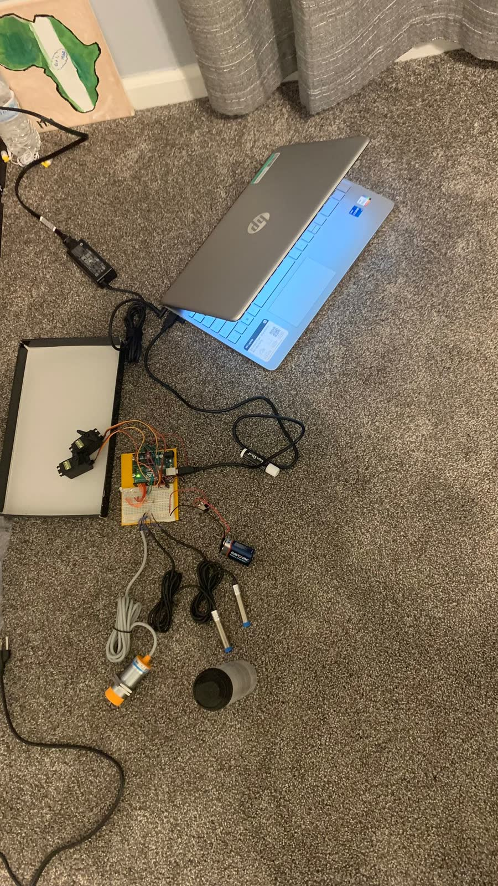
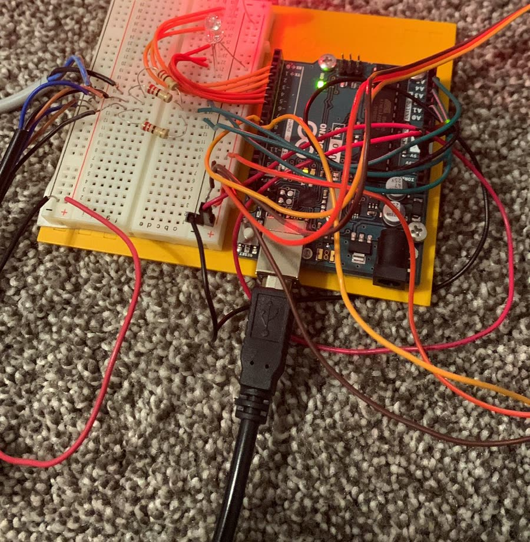
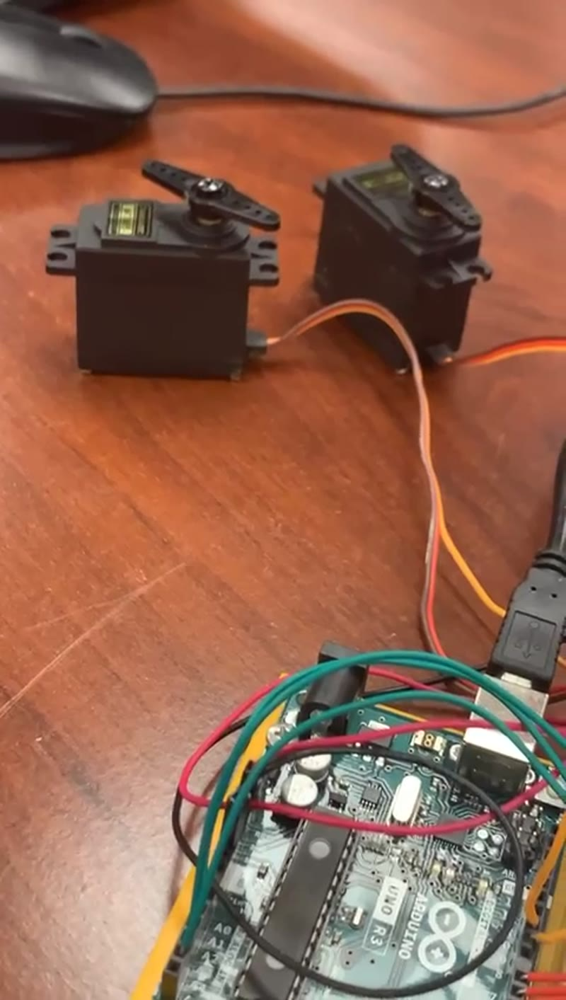

# Smart Garbage Can

An Arduino Uno R3 sketch that detects metal with one inductive proximity sensor and moves two servos when the reading crosses a threshold.

I built the hardware during an independent study in my senior year of high school (2022–2023). I had no formal training in coding or engineering. The wiring, the sensor tests, and the code were self-taught.

## What it does

The sketch reads analog pin A0.

- Above 540 counts, it treats the reading as metal. The green LED turns on, the red LED turns off, the lid servo opens, then the diverter servo moves to the metal stop.
- Below 460 counts, it treats the reading as no metal. The diverter returns home, the lid closes, the green LED turns off, and the red LED turns on.
- Between 460 and 540, it holds the previous state. That gap keeps a noisy reading near the threshold from chattering the servos.
- Each servo is commanded once per change. The loop does not call `write()` on every sample.

A reading under 460 means this sensor does not see metal. That covers an empty face and any object the sensor ignores. The sketch does not classify plastic or general waste.

The only program in the repo is [`smart_garbage_can.ino`](smart_garbage_can.ino).

## Hardware

These parts match the build photos and the silkscreen on the board.

- Arduino Uno R3
- Inductive proximity sensor with an orange sensing face and its own indicator LED. This is the sensor on A0. The part number was not written down.
- Two smaller cylindrical sensors with blue rings. They are in the bench photos. This sketch does not read them.
- Two hobby servos. During bring-up they were loose on the bench. In this sketch, pin 6 is the lid and pin 5 is the diverter.
- Green LED on pin 3 and red LED on pin 4, each with a series resistor
- Breadboard and jumper wires
- 9V battery, sitting with the sensor leads in the bench photo

## Wiring

| Uno pin | Connection |
| --- | --- |
| A0 | Signal from the inductive sensor. Keep this pin between 0 V and 5 V. |
| D3 | Green LED, through a resistor, to ground. On while metal is latched. |
| D4 | Red LED, through a resistor, to ground. On while no metal is latched. |
| D5 | Diverter servo signal. Home is 0°. Metal stop is 180°. |
| D6 | Lid servo signal. Closed is 0°. Open is 180°. |
| GND | Common ground for the Uno, the LEDs, the servo supply, and the sensor supply. |

`Servo` on the Uno uses Timer1, so `analogWrite()` on pins 9 and 10 stays unavailable while the servos are attached. This sketch does not use those pins.

Give the proximity sensor the supply it expects. A sensor of this shape often needs more than the Uno 5 V pin, which is consistent with the 9V battery in the bench photo. Give loaded servos their own 5 V to 6 V supply. Tie the grounds together. Keep the 9V battery off of A0.

## Calibrate

Open the Serial Monitor at 9600 baud. The sketch prints `idle,<counts>` or `hold,<counts>` about twice a second, and `metal,<counts>` or `no-metal,<counts>` when the state changes.

500 counts is about 2.44 V on the Uno's 5 V, 10-bit converter (`500 / 1023 * 5`). A proximity sensor that swings fully high or low will sit near 0 or near 1023, and 500 is only the midpoint. If a metal object lands on the wrong side of the test, change `sensorThreshold` in `smart_garbage_can.ino`. The on-level is that value plus 40. The off-level is that value minus 40.

`homeAngle`, `activeAngle`, and `motionSettleMs` are the mechanical settings. Bring-up used 0° and 180°. Lower `activeAngle` if a horn stalls on a stop.

## Run

1. Wire the board to the table above.
2. Install the Arduino IDE, open `smart_garbage_can.ino`, and select **Arduino Uno** and its port.
3. Upload the sketch.
4. Open the Serial Monitor at 9600 baud.
5. Hold metal on the orange face of the sensor. The green LED turns on, the lid opens, and the diverter follows. Take the metal away. The diverter returns, the lid closes, and the red LED turns on.

## Limits and next steps

The working path is metal versus no metal, with two servos and two LEDs.

The two smaller sensors in the photos are the next input. Wiring one of them, and giving that reading its own servo position, is how a second material gets added. A housing and separate bins belong after that sensor is real. None of that is in this sketch.

## Photos

Bring-up on the carpet. The orange-face sensor, the two smaller sensors, both servos, the Uno, and the 9V battery are in frame.

First LED test. The red LED is on, with series resistors on the breadboard.

Servo test. The board silkscreen reads Uno R3.

Longer clips from soldering, sensor tests, and servo tests are in this folder: [project media on Google Drive](https://drive.google.com/drive/folders/1WMvN9db4KP4SwLWDAoNWmgD6A0NWS14E?usp=sharing).

## License

MIT. See [LICENSE](LICENSE).

## Contact

mardhiata@gmail.com
